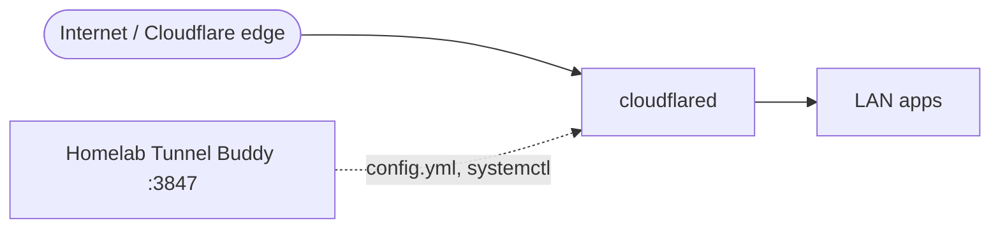

# Homelab Tunnel Buddy

Browser GUI for managing a homelab Cloudflare tunnel via `config.yml` and ingress rules.

**Target platform:** **Ubuntu Linux** 22.04 or 24.04 LTS, commonly a **Proxmox LXC** running Ubuntu (also bare metal or VM) with `cloudflared` and **systemd**.

Wraps the official [`cloudflared`](https://developers.cloudflare.com/cloudflare-one/connections/connect-apps/) binary. **Not** affiliated with Cloudflare Inc.

**Inspired by:** [itsmereal/cloudflare-tunnel-buddy](https://github.com/itsmereal/cloudflare-tunnel-buddy) (native macOS app) and [I built a simple macOS app to make Cloudflare Tunnels easier](https://itsmereal.com/i-built-a-simple-macos-app-to-make-cloudflare-tunnels-easier/) (itsmereal.com). This repo is not that project; it applies the same idea (a simple GUI for tunnel ingress and DNS) to **Ubuntu** with a browser UI and **systemd**.

**Full install from zero (Ubuntu LXC):** **[INSTALL.md](INSTALL.md)** | **Issues:** **[TROUBLESHOOTING.md](TROUBLESHOOTING.md)** | **CLI:** **[CLOUDFLARED-COMMANDS.md](CLOUDFLARED-COMMANDS.md)**

---

## Table of contents

- [What problem this solves](#what-problem-this-solves)
- [Typical homelab architecture](#typical-homelab-architecture)
- [Prerequisites (Ubuntu)](#prerequisites-ubuntu)
- [Proxmox LXC (Ubuntu)](#proxmox-lxc-ubuntu)
- [Quick start (Ubuntu)](#quick-start-ubuntu)
- [Configuration](#configuration)
- [Run on Ubuntu](#run-on-ubuntu)
- [Features](#features)
- [Tunnel logs](#tunnel-logs)
- [REST API](#rest-api)
- [Security](#security)
- [How it works internally](#how-it-works-internally)
- [Further reading](#further-reading)

Short tunnel/DNS fixes: **[TROUBLESHOOTING.md](TROUBLESHOOTING.md)** (`cloudflared tunnel cleanup`, 404 on DNS, stale connectors).

---

## What problem this solves

Cloudflare Tunnel exposes services on your LAN to the internet (or to Cloudflare Access) without opening inbound ports. Day-to-day tasks include:

- Adding a hostname -> backend URL (**ingress** rule)
- Creating DNS records for new hostnames
- Restarting `cloudflared` after config changes
- Checking whether the tunnel is connected
- Upgrading `cloudflared` via `apt`

Editing `/etc/cloudflared/config.yml` over SSH is error-prone. **Homelab Tunnel Buddy** gives you a browser UI on the LAN.

---

## Typical homelab architecture



**Direct routing (recommended)**

1. Named tunnel (e.g. `my-tunnel`) with credentials JSON under `/etc/cloudflared/` or `/root/.cloudflared/`.
2. **`/etc/cloudflared/config.yml`**: each ingress `hostname` -> **`service`** points at the app directly (e.g. `http://10.0.0.50:8080`).
3. **Homelab Tunnel Buddy** on the same **Ubuntu LXC** edits `config.yml`, controls `cloudflared.service`, and can create DNS CNAMEs.
4. Open the UI on the LAN: **`http://<ubuntu-lxc-ip-or-hostname>:3847`** (e.g. `http://tunnel-host.lan:3847`). Use **`http://`**, not `https://`, unless you terminate TLS yourself.

Optional: put a reverse proxy (e.g. Nginx Proxy Manager) in front of apps or the UI only if you want that in your stack; it is not required.

---

## Prerequisites (Ubuntu)

On the **Ubuntu** machine where the tunnel runs (LXC, VM, or bare metal):

| Requirement | Notes |
|-------------|--------|
| **Ubuntu** 22.04 or 24.04 LTS | `apt`, `systemd` |
| **Node.js 20+** | See [INSTALL.md Part 1](INSTALL.md#part-1-install-system-packages-ubuntu) |
| **`cloudflared`** | On `PATH`, typically `/usr/bin/cloudflared` |
| **Tunnel already created** | `cloudflared tunnel login`, `tunnel create`, credentials JSON |
| **`config.yml`** | `/etc/cloudflared/config.yml` (recommended) or `/root/.cloudflared/config.yml` |
| **`cloudflared.service`** | Recommended; set `HTB_CONTROL_MODE=systemd` |

### Install `cloudflared` on Ubuntu (recommended: Cloudflare apt repo)

```bash
# Add Cloudflare GPG key
sudo mkdir -p --mode=0755 /usr/share/keyrings
curl -fsSL https://pkg.cloudflare.com/cloudflare-public-v2.gpg | sudo tee /usr/share/keyrings/cloudflare-public-v2.gpg >/dev/null

# Add apt repository
echo 'deb [signed-by=/usr/share/keyrings/cloudflare-public-v2.gpg] https://pkg.cloudflare.com/cloudflared any main' | sudo tee /etc/apt/sources.list.d/cloudflared.list

# Install
sudo apt-get update && sudo apt-get install -y cloudflared
cloudflared --version
```

Official guide: [Install cloudflared](https://developers.cloudflare.com/cloudflare-one/networks/connectors/cloudflare-tunnel/downloads/)

### Example `config.yml`

Create on the server ([INSTALL.md Part 2.3](INSTALL.md#23-create-etccloudflaredconfigyml)):

```bash
sudo nano /etc/cloudflared/config.yml
```

Minimal shape:

```yaml
tunnel: my-tunnel
credentials-file: /root/.cloudflared/a1b2c3d4-e5f6-7890-abcd-ef1234567890.json
ingress:
  - hostname: app.example.com
    service: http://192.168.1.10:80
  - service: http_status:404
```

Each save from the UI writes **`config.yml.bak`** next to the config file.

---

## Proxmox LXC (Ubuntu)

Homelab setup is usually a **dedicated LXC on Proxmox** with an **Ubuntu** template (22.04 or 24.04), e.g. `tunnel-host` for `cloudflared` and Homelab Tunnel Buddy.

| Topic | Guidance |
|--------|----------|
| **OS inside the LXC** | Ubuntu LTS; all `apt` / `systemd` steps apply to the **container**, not the Proxmox host |
| **SSH target** | Connect to the **LXC IP or hostname** (`root@tunnel-host.lan`), not the Proxmox node (unless you use `pct enter`) |
| **Privileged vs unprivileged** | **Privileged** LXC (or unprivileged + nesting) is simplest for `systemd` and `cloudflared` |
| **Proxmox options** | For unprivileged: enable **Nesting** on the LXC; ensure **keyctl** if systemd warns |
| **Resources** | 512 MB RAM minimum; 1 GB+ comfortable for Node + `cloudflared` |
| **Network** | Bridge to LAN; note the LXC IP for `http://<ip>:3847` and for ingress backends |

Create the LXC in Proxmox with an **Ubuntu** template, then follow [INSTALL.md](INSTALL.md) **inside** the container (`pct enter <id>` or SSH).

**Do not** install Homelab Tunnel Buddy on the Proxmox host itself unless you intend to run the tunnel there.

---

## Quick start (Ubuntu)

Follow **[INSTALL.md](INSTALL.md)** on the Ubuntu LXC (manual steps: Node.js, cloudflared, systemd units, `.env`, `npm install` for Node dependencies).

Summary:

1. Install **Node 20** and **cloudflared** (Cloudflare apt repo).
2. `cloudflared tunnel login` / `tunnel create` / `/etc/cloudflared/config.yml` / `cloudflared.service`.
3. Copy repo to `/opt/homelab-tunnel-buddy`, run Node `npm install`, create `.env`, enable `homelab-tunnel-buddy.service`.
4. Open **`http://<ubuntu-host>:3847`** (e.g. `http://tunnel-host.lan:3847`) and enter **`HTB_API_KEY`**.

Copy from your PC:

```bash
scp -r . root@<ubuntu-host>:/opt/homelab-tunnel-buddy
```

Exclude local `node_modules`; run `npm install` on the LXC.

---

## Configuration

Settings live in **`/opt/homelab-tunnel-buddy/.env`** (loaded by `npm start` and `homelab-tunnel-buddy.service`). Copy from [`.env.example`](.env.example).

| Variable | Default (Ubuntu) | Description |
|----------|------------------|-------------|
| `PORT` | `3847` | HTTP listen port |
| `CLOUDFLARED_DIR` | `/etc/cloudflared` | Credentials and state |
| `CLOUDFLARED_CONFIG` | `/etc/cloudflared/config.yml` | File the UI edits |
| `CLOUDFLARED_PATH` | `/usr/bin/cloudflared` | Binary path |
| `CLOUDFLARED_LOG_FILE` | `/var/log/cloudflared.log` | Log file for **Tunnel logs** |
| `HTB_API_KEY` | *(empty)* | Requires `Authorization: Bearer <key>` when set |
| `HTB_CONTROL_MODE` | `systemd` | `systemd` or `spawn` |
| `HTB_SYSTEMD_UNIT` | `cloudflared.service` | Unit to start/stop/restart |
| `HTB_STATE_FILE` | `/opt/homelab-tunnel-buddy/.homelab-tunnel-buddy-running.json` | PID file when `spawn` mode |
| `CREDENTIALS_DIRS` | `/etc/cloudflared,/root/.cloudflared` | Scan paths for `*.json` |
| `CLOUDFLARED_UPDATE_MODE` | `apt` | `apt`, `dpkg`, `auto`, or `builtin` |
| `HTB_INGRESS_HOSTNAME_SUFFIX` | *(empty)* | e.g. `example.com`; UI appends suffix for short labels |
| `HTB_ROUTE_DNS_DEFAULT` | `false` | If `true`, **Create DNS CNAME** is checked by default on **Add route**; when saved, runs `cloudflared tunnel route dns` |

Generate an API key on Ubuntu:

```bash
openssl rand -hex 32 | sudo tee -a /opt/homelab-tunnel-buddy/.env
# Or edit: sudo nano /opt/homelab-tunnel-buddy/.env
sudo chmod 600 /opt/homelab-tunnel-buddy/.env
sudo systemctl restart homelab-tunnel-buddy
```

### Control modes

**`systemd` (recommended on Ubuntu):** the UI runs `systemctl start|stop|restart` on `cloudflared.service`.

Example `/etc/systemd/system/cloudflared.service` `ExecStart` (with log file for the UI):

```ini
ExecStart=/usr/bin/cloudflared --no-autoupdate --loglevel info --logfile /var/log/cloudflared.log --config /etc/cloudflared/config.yml tunnel run
```

```bash
sudo touch /var/log/cloudflared.log
sudo chmod 644 /var/log/cloudflared.log
sudo systemctl daemon-reload
sudo systemctl enable --now cloudflared
```

**`spawn`:** only if **no** `cloudflared.service` is managing the tunnel (avoid two daemons).

---

## Run on Ubuntu

### Production (systemd)

```bash
sudo systemctl status homelab-tunnel-buddy
sudo systemctl restart homelab-tunnel-buddy
sudo journalctl -u homelab-tunnel-buddy -f
```

### One-off / debugging

```bash
cd /opt/homelab-tunnel-buddy
sudo npm start
```

### LAN URL

| Access | URL |
|--------|-----|
| By IP | `http://<host-ip>:3847` |
| By hostname | `http://tunnel-host.lan:3847` (if LAN DNS points at the LXC) |

1. Complete [INSTALL.md](INSTALL.md) on the LXC.
2. Open the UI with **`http://`** (see [TROUBLESHOOTING.md](TROUBLESHOOTING.md) if the browser reports a network error).
3. Enter **`HTB_API_KEY`** from `.env` when prompted.
4. Add ingress routes with **direct** backend URLs (e.g. `http://10.0.0.50:8080`).

If **homelab-tunnel-buddy** or **cloudflared** misbehaves, see **[TROUBLESHOOTING.md](TROUBLESHOOTING.md)**.

---

## Features

Sidebar: **Ingress routes**, **Tunnel**, **Cloudflared**, **Tunnel logs**, **Settings** (Tunnel config, App & paths).

- **Ingress:** add/edit/delete `hostname` -> `service`; optional DNS via `cloudflared tunnel route dns`
- **Tunnel:** status, start/stop/restart via systemd; auto-restart after ingress changes
- **Cloudflared:** version, login hint, upgrade via `apt-get install --only-upgrade cloudflared`
- **Tunnel logs:** tail `/var/log/cloudflared.log` (requires `--logfile` on `cloudflared`)
- **Settings:** tunnel name, credentials path, read-only `.env` paths

---

## Tunnel logs

1. Add `--logfile /var/log/cloudflared.log` to `cloudflared` `ExecStart` (see above).
2. Set `CLOUDFLARED_LOG_FILE` in `.env` if you use a different path.
3. `homelab-tunnel-buddy.service` runs as `root` by default so it can read the log.
4. UI -> **Tunnel logs** (polls every 2s when live tail is on).

---

## REST API

Base path: `/api` (JSON). With `HTB_API_KEY` set, send `Authorization: Bearer <key>` or `X-API-Key: <key>`. Public: `GET /api/health`, `GET /api/meta`.

| Method | Path | Description |
|--------|------|-------------|
| `GET` | `/health` | Liveness |
| `GET` | `/meta` | Paths, control mode, auth required |
| `GET` | `/config` | Parsed `config.yml` |
| `PUT` | `/config` | Update tunnel name / credentials path |
| `GET` | `/config/ingress` | Ingress rules |
| `POST` | `/config/ingress` | Add rule |
| `PATCH` | `/config/ingress/:index` | Update rule |
| `DELETE` | `/config/ingress/:index` | Delete rule |
| `GET` | `/tunnel/status` | Running / Cloudflare connection |
| `POST` | `/tunnel/start` \| `/stop` \| `/restart` | Control tunnel |
| `GET` | `/cloudflared/status` | Install, auth, version |
| `GET` | `/cloudflared/logs` | Tail log file |
| `POST` | `/cloudflared/update` | Upgrade via apt/dpkg |

Full list: [`server/routes/api.js`](server/routes/api.js).

---

## Security

- **Trusted LAN only.** Not a public admin panel.
- Use a long random **`HTB_API_KEY`**; the UI stores it in `sessionStorage` under `htb_api_key`.
- Credential JSON **contents** are never returned (paths only).
- `config.yml.bak` on each save.
- Do not commit `.env` or `*.json` credentials to git.
- `chmod 600 /opt/homelab-tunnel-buddy/.env`

---

## How it works internally

1. **`config-yml.js`:** read/write Cloudflare YAML (`tunnel`, `credentials-file`, `ingress`).
2. **`tunnel-manager.js`:** `systemctl` or spawn `cloudflared tunnel run`.
3. **`cloudflare.js`:** CLI wrappers; Ubuntu upgrades via `apt`/`dpkg`.
4. **`cloudflared-log.js`:** tail `CLOUDFLARED_LOG_FILE`.
5. **Frontend:** vanilla JS (`api.js`, `app.js`, `logs.js`).

After ingress changes, the API can restart the tunnel when `restart` is true and the tunnel was running.

---

## Further reading

- [Cloudflare Tunnel docs](https://developers.cloudflare.com/cloudflare-one/connections/connect-apps/)
- [Install cloudflared on Linux](https://developers.cloudflare.com/cloudflare-one/connections/connect-apps/install-and-setup/installation/)
- [Useful commands (Cloudflare)](https://developers.cloudflare.com/cloudflare-one/networks/connectors/cloudflare-tunnel/do-more-with-tunnels/local-management/tunnel-useful-commands/), summarized in **[CLOUDFLARED-COMMANDS.md](CLOUDFLARED-COMMANDS.md)**
- **Ubuntu on Proxmox LXC walkthrough:** [INSTALL.md](INSTALL.md)
- **Troubleshooting (UI, systemd, DNS, LXC):** [TROUBLESHOOTING.md](TROUBLESHOOTING.md)

---

## License

MIT (see `package.json`). **Homelab Tunnel Buddy** is a third-party tool; not affiliated with Cloudflare Inc.
